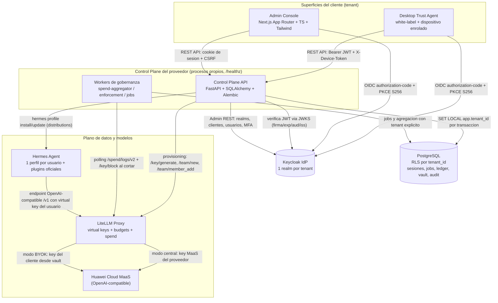
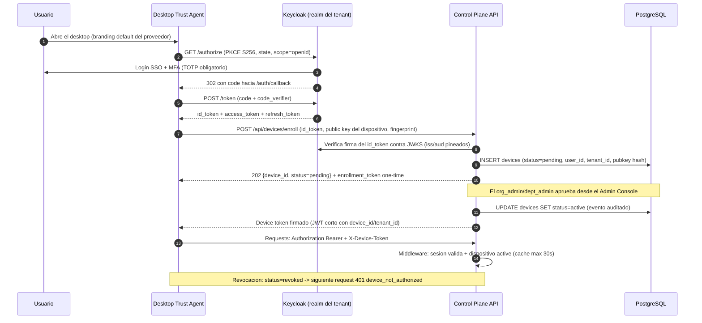
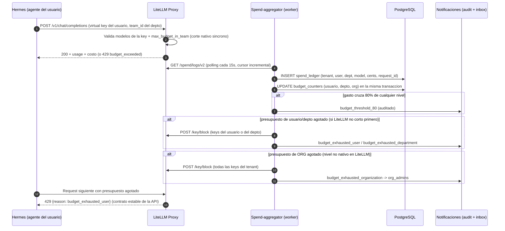
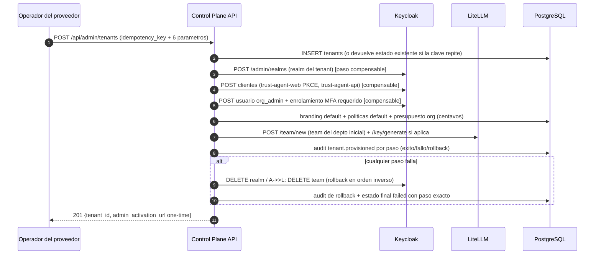

# Arquitectura de la plataforma Trust Agent

| Campo | Valor |
|---|---|
| **Estado** | Fase *arquitectura* (SDD) — insumo vinculante para specs 002 (schema) y 003 (control plane) |
| **Versión** | 1.0.0 |
| **Fecha** | 2026-10-23 |
| **Autor** | dev (tarea t_3d122253) |
| **Fuentes** | `DECISIONES.md` (D1–D5), `auditoria/AUDITORIA-AIDLC.md` (C1–C6, P1–P7, I1–I10), `specs/001-platform/spec.md` (112 REQ EARS), `docs/investigacion.md` (hallazgos probados e2e), skills `hermes-plugins-extension`, `litellm-proxy-governance`, `keycloak-admin-oidc`, `postgresql-rls-multitenant`, `hermes-saas-governance` |
| **Idioma/moneda** | Español (docs) / inglés (UI copy, código) / USD en centavos enteros |

> Convención de trazabilidad: cada sección cita los requisitos de `specs/001-platform/spec.md` (`REQ-XXX`) y las decisiones/lecciones (`D#`, `C#`, `I#`, `P#`) que satisface. Los ADR son normativos: una implementación que contradiga un ADR requiere un ADR nuevo que lo reemplace, con razón documentada.

---

## 1. Principios arquitectónicos

Derivados del constitution y de la spec maestra; toda decisión de más bajo nivel hereda de estos:

1. **El producto ES la gobernanza** (constitution V): cada componente existe para gobernar una capacidad (quién, con qué presupuesto, bajo qué política, auditado). Ningún camino de datos evita el control plane.
2. **Aislamiento lógico multi-tenant** (constitution III, D2, C3): control plane compartido, `tenant_id` en toda tabla y toda query, RLS de PostgreSQL como defensa en profundidad. El aislamiento no depende de que el código de aplicación sea correcto.
3. **Estado en PostgreSQL, nunca en memoria** (C2): sesiones, jobs, contadores de presupuesto, rate-limit counters y audit viven en la DB. Cualquier proceso puede morir y reiniciarse sin perder estado.
4. **Cero parches al core de Hermes** (C6, regla 5 de CONTEXTO-TAREAS): la integración con Hermes Agent se hace exclusivamente con plugins oficiales (`plugin.yaml` + `register(ctx)`), profile distributions y configuración por perfil.
5. **Latencia de gobernanza ≤ 60 s** (spec §9.4): todo corte, revocación o cambio de política es efectivo en ≤ 60 s. La arquitectura reserva un presupuesto de latencia por mecanismo (§7).
6. **Secretos one-time y cifrados en reposo** (C1, C4): un secreto aparece una única vez en la respuesta que lo genera; en reposo solo hay ciphertext con envelope encryption.
7. **Desarrollo local primero** (D5, constitution VII): single-node, cada servicio como proceso propio con healthcheck (REQ-SEC-009), puertos locales fijos (§3.10).
8. **Catálogos = datos por tenant** (I10): modelos, conectores, claves de política y plantillas de perfil son filas de DB, nunca constantes de código.

---

## 2. Diagrama de arquitectura

### 2.1 Vista de componentes



### 2.2 Vista de flujo de enrolamiento de dispositivo (ADR-013)



### 2.3 Vista de flujo de presupuesto jerárquico y corte (ADR-014)



### 2.4 Vista de aprovisionamiento de tenant (REQ-ONB)



---

## 3. Componentes

### 3.1 Control Plane API (FastAPI) — `platform/app/`

**Responsabilidad**: único punto de entrada de administración y gobernanza. Expone la REST API del Admin Console y del desktop, ejecuta el aprovisionamiento, y es el único escritor de la configuración de gobernanza (políticas, presupuestos, grants, dispositivos, conectores, vault, branding).

- **Stack** (constitution VI): Python + FastAPI + SQLAlchemy 2 + Alembic; Pydantic v2 para contratos; PyJWT + `PyJWKClient` para verificación JWKS.
- **Estructura de módulos** (vinculante para la spec 003 / tarea t_028016e6):
  ```
  platform/
  ├── pyproject.toml
  ├── alembic/                     # migraciones (dueño logico: spec 002)
  ├── app/
  │   ├── main.py                  # factory + middlewares + /healthz
  │   ├── config.py                # settings por env (puertos, KEK ref, issuer)
  │   ├── db.py                    # engine, session factory, SET LOCAL tenant_id
  │   ├── auth/                    # OIDC code+PKCE, verificacion JWKS, sesiones DB
  │   ├── tenants/                 # aprovisionamiento idempotente + rollback
  │   ├── governance/              # politicas deny-overrides, presupuestos, grants
  │   ├── models/                  # model access, catalogo, pricing sync, BYOK
  │   ├── devices/                 # enrolamiento, device tokens, revocacion
  │   ├── connectors/              # catalogo, instancias, mensajerias
  │   ├── vault/                   # envelope encryption, one-time secrets
  │   ├── audit/                   # hash chain, consulta filtrada, verificador
  │   ├── profiles/                # plantillas Hermes, profile distributions
  │   └── jobs/                    # jobs en DB + workers (spend-aggregator, etc.)
  └── tests/                       # unit + isolation/ + e2e/
  ```
- **Middlewares** (orden de ejecución):
  1. `RequestContext` — genera `request_id`, abre transacción.
  2. `TenantScope` — resuelve `tenant_id` del principal autenticado y ejecuta `SET LOCAL app.tenant_id` **dentro de la transacción** (pitfall verificado: `SET` de sesión + pool fuga tenant entre requests).
  3. `Authentication` — valida sesión (DB) o JWT (JWKS: firma, `exp`, `aud`, `iss`; jamás decode sin validar — REQ-SEC-002).
  4. `DeviceGate` — para rutas de negocio exige `X-Device-Token` con dispositivo `active` (REQ-DEV-003); cache de estado ≤ 30 s.
  5. `MfaGate` — token sin MFA enrolada → 403 `mfa_required` salvo rutas de enrolamiento (REQ-ORG-007).
  6. `Rbac` — aplica la matriz §2.1 de la spec (capacidad × rol, test generado desde la matriz).
  7. `RateLimit` — login y endpoints sensibles; contadores en DB (REQ-SEC-006).
- **Sesiones**: registro en PostgreSQL (`sessions` con `id`, `user_id`, `tenant_id`, `device_id`, `expires_at`, `revoked_at`). El Admin Console usa cookie `Secure`+`HttpOnly`+`SameSite=Lax` + token CSRF en mutaciones (REQ-SEC-010); el desktop usa Bearer + refresh con rotación. Reiniciar el API no invalida nada (AC-SEC-003).
- **Jobs**: tabla `jobs` (`id`, `tenant_id`, `type`, `payload`, `status`, `result`, `attempts`) con workers que los reclaman con `SELECT ... FOR UPDATE SKIP LOCKED`. Nada de `_JOBS` en memoria (C2).
- **Cero estado en memoria de proceso** para nada que deba sobrevivir un restart.

### 3.2 Admin Console (Next.js) — `console/`

- **Stack**: Next.js App Router + TypeScript + Tailwind CSS (constitution VI). Server Components consumen la REST API del control plane con la cookie de sesión; ninguna query directa a la DB.
- **Vistas** (1:1 con el mockup): Overview, Organization, Departments, Users & Roles, Budgets, Model Access, Shared Agents, Devices, Credentials, Audit Log, Branding.
- **Branding en runtime** (REQ-BRD-002): el layout raíz lee `GET /api/branding` del tenant en cada carga; cambiar branding no requiere redeploy.
- **Errores de gobernanza**: toda pantalla mapea el `reason` del backend a copy en inglés específico (REQ-DTK-007); jamás un error genérico.
- **Sin lógica de negocio**: el console es una vista; la autorización vive en el API (el mismo endpoint sirve al desktop).

### 3.3 Desktop Trust Agent + enrolamiento — `desktop/`

- **Qué es**: cliente de usuario final (white-label, D3) que autentica por OIDC authorization-code + PKCE S256 contra el realm del tenant (REQ-DTK-001), liga el dispositivo a la organización (ADR-013) y ejecuta/usa agentes Hermes del perfil del usuario.
- **Responsabilidades**: login PKCE con navegador del sistema, generación del par de claves del dispositivo y enrolamiento, presentación del home (sesiones, capacidades, agentes compartidos, artefactos, acciones rápidas), vault del usuario (registro one-time), y arranque de sesiones de agente contra el gateway.
- **NO hace**: decisiones de gobernanza. Todo lo que muestra lo pide al control plane (`GET /api/me/policies`, `/api/agents/shared`, `/api/overview/dept`); si el backend dice 403/429, muestra el `reason`.
- **Branding**: default del proveedor pre-login; el del tenant post-login (REQ-BRD-003), leído del API en runtime.

### 3.4 LiteLLM Proxy — plano de control de modelos

- **Rol** (D4, P1): único camino hacia los modelos. Hermes (y cualquier consumidor) habla con el endpoint OpenAI-compatible de LiteLLM con una **virtual key por usuario**; LiteLLM aplica modelos permitidos, `max_budget`/`budget_duration` y registra spend.
- **Reglas duras**:
  - Siempre con `DATABASE_URL` PostgreSQL: **sin DB los budgets fallan abiertos** (pitfall verificado, docs oficiales).
  - `litellm_settings.overwrite_user_with_key_hash: true` y `user_id` siempre seteado al emitir keys (el campo `user` del body es auto-declarado → spoofing de spend).
  - `budget_exceeded_status_code: 429` para que el corte hable el contrato HTTP de la plataforma.
  - Pricing MaaS: `model_info` con precios por modelo o cost map propio (`LITELLM_MODEL_COST_MAP_URL`); sin pricing el spend sale $0 con WARNING (pitfall MaaS). Refresh en caliente vía `POST /reload/model_cost_map` + schedule 6h (job `pricing_sync`, REQ-MDL-004).
- **Mapeo jerárquico** (detalle en ADR-014 y contrato §5.3): depto = team con `max_budget`+`budget_duration`; usuario = miembro con `max_budget_in_team`; key por usuario con `team_id` (ojo: con `team_id` **no** aplica el budget personal del dueño — el corte de usuario lo da `max_budget_in_team`).
- **Modos por modelo/tenant** (REQ-MDL-003): central (key MaaS del proveedor; el ledger registra `costo_base × (1+margen)`) y BYOK (key del cliente desde el vault; ledger a `costo_base`). La gobernanza (presupuesto, corte, audit) aplica a ambos (REQ-BUD-011).
- **Aislamiento**: la plataforma nunca expone `LITELLM_MASTER_KEY` a tenants; el API del control plane es el único emisor de keys. Servicios internos (mem0 u otros) que consuman modelos reciben su propia key con budget — jamás la master key (hallazgo alto de la auditoría: gasto no atribuible).

### 3.5 IdP OIDC (Keycloak) — identidad

- **Topología** (spec §9.10): **1 realm por tenant**, con clientes `trust-agent-web` (público, PKCE S256, `directAccessGrantsEnabled: false`) y `trust-agent-api` (confidencial, service-to-service interno si se requiere). El claim `tenant_id` viaja firmado en el token (mapper desde atributo del realm/cliente) → tokens de un tenant no son válidos en otro (AC-TEN-005).
- **Flujo de usuarios finales**: authorization-code + PKCE S256 + MFA TOTP obligatorio (WebAuthn opcional, REQ-SEC-011). ROPC prohibido para usuarios finales (REQ-SEC-001); solo se admite `admin-cli`/cliente confidencial para el **bootstrap interno del control plane** (Admin REST), documentado aquí como la única excepción.
- **MFA enrolamiento**: vía **Admin REST API oficial** (`required-actions`, `reset-password`, etc.) — jamás scraping del HTML de la consola de login (C5). Verificado e2e en la investigación (realm `trust-agent-test`, 7/7 OK).
- **Verificación de tokens**: el control plane (y el plugin Hermes) validan firma contra JWKS con `iss`/`aud` pineados, `exp`/`iat` requeridos, leeway 60 s, **RS256/ES256 solamente** (HS256 excluido: algorithm confusion).
- **Admin REST**: el aprovisionamiento crea realms/clientes/usuarios por API (REQ-ONB-008, idiom-proof); cada paso es compensable (rollback).

### 3.6 Vault de credenciales — envelope encryption

- **Modelo** (REQ-VLT-001, C4, I6): cada credencial tiene su **DEK** (AES-256-GCM) que cifra el secreto; la DEK se cifra con una **KEK maestra** que vive en variable de entorno / KMS local — **nunca en la DB**. En la DB solo hay `ciphertext_dek` + `ciphertext_secret` + metadatos.
- **One-time** (REQ-VLT-002, C1): el valor en claro aparece únicamente en la respuesta de registro/rotación; `GET` devuelve solo metadatos; grep de canarios en logs/respuestas = 0 (AC automatizado).
- **Inyección en runtime** (REQ-VLT-003): los conectores del agente reciben la credencial descifrada en memoria del proceso del conector; el secreto jamás entra al transcript, contexto del modelo ni artefactos (test con valor canario).
- **Scoping**: tipos permitidos por política (`vault_allowed_credential_types`), scope mínimo del catálogo de conectores (REQ-CON-006), revocación con corte ≤ 60 s de las conexiones que la usan (REQ-VLT-005).
- **BYOK**: las keys de modelos del cliente son credenciales del vault como cualquier otra (REQ-MDL-007); LiteLLM las consume vía referencia cifrada generada por el control plane, nunca en texto claro en config.

### 3.7 Audit log — inmutable y encadenado

- **Tabla `audit_log`** (I7): INSERT-only. A nivel de **base de datos**: sin `GRANT UPDATE/DELETE` al rol de app + trigger `BEFORE UPDATE OR DELETE` que lanza excepción (REQ-AUD-001). La purga por retención (≥ 365 días, invariable) es un job dedicado que archiva y registra `audit.purged` (REQ-AUD-006).
- **Hash chain por tenant** (REQ-AUD-002): `hash = sha256(hash_prev || canonical_json(payload))`, con `hash_prev` de la fila anterior del tenant (secuencia materializada con `seq` por tenant para evitar carreras). CLI/endpoint `verify-audit-chain <tenant>` → `OK` o fila exacta inconsistente (REQ-AUD-007).
- **Cobertura** (REQ-AUD-003): auth, usuarios/roles, políticas, presupuestos, grants, dispositivos, conectores, vault, modelos (aprobación y consumo con costo), acciones del proveedor. Todo evento: `actor`, `tenant_id`, `action`, `target`, `device_id?`, `cost_cents?`, `ts`, `hash_prev`, `hash`.
- **Alcance por rol** (REQ-AUD-004): org_admin ve su tenant; dept_admin su depto; user sus propios eventos — mismo mecanismo RLS + filtro.

### 3.8 Workers de gobernanza (procesos propios)

- `spend-aggregator` — polling de `/spend/logs/v2` con cursor incremental cada 15 s; escribe `spend_ledger` + actualiza `budget_counters` en una transacción por lote; dispara umbrales 80 % y cortes (ADR-014).
- `enforcement` — ejecuta cortes diferidos: `/key/block` en LiteLLM, invalidación de sesiones/devices, desconexión de conectores (REQ-CON-005), suspensión de tenant (REQ-TEN-006). Idempotente y con backoff.
- `job-runner` — reclama jobs de la tabla `jobs` (provisioning de usuarios, pricing_sync, purga de audit, instalación de perfiles).
- Todos: proceso separado del API, `/healthz` propio, state en DB (REQ-SEC-009), reinicio independiente.

### 3.9 PostgreSQL — corazón de estado

- **Una instancia, roles separados**: `app_api` (sin `BYPASSRLS`, **no dueño** de tablas, sin `TRUNCATE`), `app_worker`, `migrator` (dueño, con `FORCE ROW LEVEL SECURITY` activo en tablas de negocio para que ni el dueño salte políticas — pitfall verificado), `audit_app` (INSERT-only sobre `audit_log`).
- **RLS** (REQ-TEN-001, patrón probado 4/4): política `USING/WITH CHECK (tenant_id = current_setting('app.tenant_id', true))` en **todas** las tablas de negocio; default-deny sin tenant seteado; `SET LOCAL`/`set_config(..., true)` dentro de la transacción; índices compuestos `(tenant_id, ...)`.
- **Dueño del schema físico**: spec 002 (tarea t_26caf0c0). Esta arquitectura fija los **contratos lógicos** (§5) que ese schema debe satisfacer; los nombres físicos los decide 002 sin romper los contratos.
- **Montos**: `BIGINT` centavos, nunca float (spec §9.1).

### 3.10 Topología local (D5) — puertos y procesos

| Servicio | Puerto | Proceso | Healthcheck |
|---|---|---|---|
| Control Plane API | `127.0.0.1:8000` | `uvicorn app.main:app` | `GET /healthz` |
| Admin Console | `127.0.0.1:3000` | `next start` | `GET /api/health` (proxy a `/healthz` del API) |
| LiteLLM Proxy | `127.0.0.1:4000` | `litellm --config config.yaml` | `GET /health/liveliness` |
| Keycloak | `127.0.0.1:8080` | contenedor `quay.io/keycloak/keycloak:26.x` (tag pineado) | `GET /realms/master/.well-known/openid-configuration` |
| PostgreSQL | `127.0.0.1:5432` | contenedor `postgres:17` (tag pineado) | `pg_isready` |
| Workers | — | `python -m app.jobs.worker <kind>` | fila de heartbeat en `jobs` + `/healthz` HTTP en puerto alto |

Reglas: imágenes **siempre pineadas** (nunca `:latest` — hallazgo alto de la auditoría), cada servicio reiniciable de forma independiente, TLS `verify=True` en toda conexión interna/externa (REQ-SEC-007).

---

## 4. ADRs (Architecture Decision Records)

> Formato: Contexto / Decisión / Alternativas / Consecuencias. `Estado: Aceptado` salvo indicación.

### ADR-001 (D1) — Plataforma nueva desde cero; AIDLC es solo referencia

- **Contexto**: existe un prototipo funcional (AIDLC) con Keycloak + LiteLLM + bot Hermes, pero la auditoría (C1–C6, hallazgos altos) muestra: single-tenant por diseño, sin base de datos (JSONs planos sin lock), secretos en claro, sesiones en memoria, parches al core de Hermes por sobrescritura, MFA por scraping HTML, `verify=False`. Veredicto unánime: no sirve como base de código.
- **Decisión**: construir la plataforma desde cero (FastAPI + PostgreSQL + Next.js + LiteLLM + Keycloak), reutilizando de AIDLC **solo patrones conceptuales** (P1–P7: LiteLLM como plano de control, cliente Admin REST de Keycloak, provisioning con rollback, gobernanza own/invoke/view) y **ninguna línea** de su modelo de datos ni de sus parches.
- **Alternativas**: (a) refactorizar AIDLC — rechazada: el costo de revertir C1–C6 supera el de construir limpio; (b) fork — rechazada por idéntica razón.
- **Consecuencias**: ↑ esfuerzo inicial; ↓ deuda estructural; los patrones buenos se preservan como decisiones (ADR-012, ADR-014) en lugar de como código.

### ADR-002 (D2) — Multi-tenancy: control plane compartido + aislamiento lógico con RLS

- **Contexto**: el SaaS sirve N clientes con un solo despliegue (D5 local primero). AIDLC era single-tenant (C3): un realm, cualquier admin ve todo, sin `tenant_id` — bloqueador directo.
- **Decisión**: control plane compartido; `tenant_id` en **toda** tabla de negocio y todo query; RLS de PostgreSQL como defensa en profundidad (el middleware setea `SET LOCAL app.tenant_id` por transacción; la política filtra aunque el código se equivoque). Identidad aislada por realm del tenant con claim `tenant_id` firmado (AC-TEN-005). Ninguna vía de acceso sin scope de tenant (REQ-TEN-002).
- **Alternativas**: (a) base de datos por tenant — rechazada: N migraciones, N conexiones, imposible en single-node local y caro en SaaS; (b) aislamiento solo a nivel de aplicación (WHERE tenant_id) — rechazado: un bug de aplicación filtra datos; RLS lo impide a nivel de DB (probado 4/4 en PostgreSQL 17).
- **Consecuencias**: disciplina de `SET LOCAL` en toda transacción (pool + `SET` de sesión = fuga de tenant, pitfall verificado); suite de aislamiento `tests/isolation/` bloqueante en CI (REQ-TEN-003); migraciones/admin requieren rol dedicado auditado.

### ADR-003 (D3) — Desktop white-label con enrolamiento de dispositivo de primera clase

- **Contexto**: el usuario final descarga un desktop del proveedor y lo liga a su organización (DECISIONES §alcance 4). AIDLC no tenía concepto de dispositivo; el acceso era "usuario + password", sin ligadura de hardware ni aprobación (I5).
- **Decisión**: el desktop es white-label desde el primer día (branding default del proveedor pre-login, branding del tenant post-login, leído en runtime — REQ-BRD-003). El **dispositivo** es una entidad de primera clase con ciclo de vida `pending → active → revoked` (ADR-013), token de dispositivo firmado y gate en middleware. El tenant es el default de ligado.
- **Alternativas**: (a) desktop por tenant empaquetado — rechazada: N binarios, branding requiere re-empaquetado (viola REQ-BRD-002); (b) sin enrolamiento de dispositivo (solo login) — rechazada: REQ-DEV-001…006 y el pitch de gobernanza enterprise lo exigen.
- **Consecuencias**: el instalador es uno solo; el branding vive en la DB; el middleware valida dispositivo en cada request de negocio (cache ≤ 30 s para cumplir revocación ≤ 60 s).

### ADR-004 (D4) — Modelos vía LiteLLM: MaaS central con margen + BYOK, siempre gobernados

- **Contexto**: el proveedor quiere cobrar el uso de modelos con margen (keys MaaS centralizadas) y los clientes quieren poder usar sus propias keys (BYOK). AIDLC ya validó LiteLLM como plano de control (P1) pero sin jerarquía de presupuestos ni atribución completa (mem0 con master key).
- **Decisión**: **todo** consumo de modelos pasa por LiteLLM (no existe camino directo a MaaS desde Hermes). Dos modos por modelo/tenant: central (key del proveedor; ledger con `costo_base × (1+margen)`, margen configurable por tenant) y BYOK (key del cliente, cifrada en el vault, consumida por LiteLLM por referencia; ledger a `costo_base`). En ambos modos la gobernanza es idéntica: virtual key por usuario, presupuesto, corte, audit (REQ-BUD-011).
- **Alternativas**: (a) solo modo central — rechazada: pierde clientes enterprise con requisitos de keys propias; (b) BYOK directo desde Hermes sin gateway — rechazada: evadiría presupuestos, políticas y audit (viola constitution V).
- **Consecuencias**: pricing MaaS debe mantenerse (job `pricing_sync` + `model_info`, pitfall del cost map); el vault se vuelve dependencia del plano de modelos (BYOK); el margen es dato por tenant, no constante.

### ADR-005 (D5) — Desarrollo local primero; PostgreSQL como única fuente de estado

- **Contexto**: el entregable es código + evidencia en este servidor (constitution VII), no infraestructura. AIDLC usaba JSONs planos bajo PVC sin locks y con carreras entre threads (hallazgo alto).
- **Decisión**: single-node local; PostgreSQL 17 es el **único** store de estado (negocio, sesiones, jobs, ledger, vault ciphertext, audit, contadores de rate-limit). Cada servicio es un proceso propio con healthcheck (REQ-SEC-009). Imágenes pineadas. Nada de despliegue productivo sin autorización explícita del humano.
- **Alternativas**: (a) Redis para sesiones/contadores — rechazada por ahora: un store menos que operar en local; los contadores en DB con `SKIP LOCKED` bastan a esta escala (revisar si el throughput lo exige); (b) SQLite — rechazada: sin RLS real ni concurrencia adecuada.
- **Consecuencias**: el diseño es portable a contenedores sin cambios lógicos (proceso por servicio ya está separado); el rendimiento de spend-aggregation depende de índices `(tenant_id, ...)` correctos.

### ADR-006 (C1) — Secretos one-time: jamás en respuestas persistentes ni logs

- **Contexto (por qué NO)**: AIDLC devolvía la password reseteada en el cuerpo JSON de la respuesta (`reset-password`), exponiéndola a navegador, proxies y logs. C4 agravaba: TOTP secrets y virtual keys en texto claro en archivos JSON/YAML.
- **Decisión**: todo secreto efímero (password reset, enlace de activación, token de enrolamiento, valor de credencial del vault) se entrega **una única vez** en la respuesta que lo genera; canje único (segundo uso → 410); `GET` posteriores devuelven solo metadatos; grep automatizado de canarios en logs y respuestas = 0 (AC-SEC-004, AC-VLT-002).
- **Alternativas**: mostrar el secreto en la UI cada vez que el admin lo pida — rechazada: multiplica la superficie de exposición (proxies, screenshots, logs de browser).
- **Consecuencias**: UX de "copiar ahora o rotar después"; rotación como operación de primera clase (REQ-VLT-002).

### ADR-007 (C2) — Sesiones y jobs en PostgreSQL; cero estado de gobernanza en memoria

- **Contexto (por qué NO)**: AIDLC mantenía `_SESSIONS` como dict en memoria: sin expiración server-side, cookie sin `Secure`, token predecible (`base64(username:hex)`), todo perdido al reiniciar; jobs `_JOBS` igual; el panel y el SSH corrían como nohup dentro del pod y morían silenciosos.
- **Decisión**: sesiones, jobs, contadores y throttles en PostgreSQL (§3.1, §3.8). Cookies `Secure`+`HttpOnly`+`SameSite=Lax` + CSRF (REQ-SEC-010). Tokens de sesión opacos/aleatorios (no derivables del username). Reiniciar el API no invalida sesiones ni pierde jobs (AC-SEC-003).
- **Alternativas**: sesiones JWT stateless sin revocación — rechazada: la revocación ≤ 60 s (REQ-ORG-005, REQ-DEV-004) exige estado server-side.
- **Consecuencias**: toda request autenticada consulta la sesión en DB (aceptable en local; cache corto si el perfil de carga lo pide, con TTL < 30 s para no romper la revocación ≤ 60 s).

### ADR-008 (C3) — `tenant_id` en toda la capa; aislamiento verificable, no asumido

- **Contexto (por qué NO)**: AIDLC era single-tenant por diseño: sin `tenant_id` en ninguna capa, un realm KC, cualquier platform-admin ve TODO. No era un bug aislado: era la arquitectura completa la que no representaba al tenant.
- **Decisión**: además del RLS de ADR-002, la suite `tests/isolation/` (≥ 1 caso negativo por dominio: usuarios, presupuestos, políticas, dispositivos, conectores, vault, audit, agentes, modelos) es **bloqueante** en CI (REQ-TEN-003). Cross-tenant por IDs forjados responde 404 (no filtrable). El Admin Console del tenant A no tiene ni una ruta hacia el cross-plane.
- **Alternativas**: confiar en el middleware + code review — rechazado: el aislamiento que no se prueba regresa con el primer refactor.
- **Consecuencias**: costo de test suite amplio; detección temprana de fugas; requisito de que los tests generen sus fixtures por tenant.

### ADR-009 (C4) — Vault con envelope encryption; KEK fuera de la DB

- **Contexto (por qué NO)**: AIDLC guardaba virtual keys de LiteLLM en config.yaml del perfil, secrets TOTP en `ssh-credentials.json` y los devolvía en respuestas de API — todo en texto claro, sin cifrado en reposo.
- **Decisión**: envelope encryption (§3.6): DEK AES-256-GCM por credencial; KEK maestra en entorno/KMS local, jamás en la DB ni en el repo; en la DB solo ciphertext. Dump de la tabla sin la KEK es criptográficamente inútil (AC-VLT-001). Aplica a credenciales de conectores, keys BYOK, seeds TOTP y cualquier secreto del tenant (REQ-SEC-005).
- **Alternativas**: cifrar todo con una sola key global — rechazado: rotación granular imposible y blast radius total; secrets en variables de entorno por servicio — rechazado: no escala a cientos de credenciales de usuarios ni permite rotación self-service.
- **Consecuencias**: la KEK es un secreto crítico de operación (backup documentado, jamás en el repo); rotación de KEK = re-cifrar DEKs (job, sin tocar datos).

### ADR-010 (C5) — MFA enrolada vía Admin REST oficial; jamás scraping de la consola Keycloak

- **Contexto (por qué NO)**: AIDLC enrolaba MFA haciendo scraping del HTML de login de Keycloak (regex + decodificar el QR con cv2) con verificación TLS desactivada, y la regeneración reseteaba la password como efecto secundario. Frágil ante cualquier upgrade de Keycloak (26.x ya rompió VERIFY_PROFILE).
- **Decisión**: el enrolamiento MFA (TOTP mínimo; WebAuthn opcional REQ-SEC-011) se hace con la **Admin REST API oficial** de Keycloak (`required-actions`, execute-actions-email) o con el flujo nativo del realm (el usuario escanea su QR en la consola del IdP, no en un HTML scrapeado). El control plane jamás parsea HTML de Keycloak.
- **Alternativas**: mantener el scraper — rechazada: se rompe con cada minor de KC y ya demostró efectos secundarios; ROPC+TOTP propio — rechazada: ROPC deprecado en OAuth 2.1 y bypasea MFA resistente a phishing.
- **Consecuencias**: dependencia de la Admin REST (estable y versionada); el primer login obliga enrolamiento vía `required-actions` del realm (REQ-ONB-004).

### ADR-011 (C6) — Cero parches al core de Hermes; TLS `verify=True` siempre

- **Contexto (por qué NO)**: AIDLC aplicaba parches por **sobrescritura de archivos core** en postStart (`login_page.py`, `routes.py`, `self_hosted/__init__.py`) con `|| true`, sin verificación de sintaxis previa, sin rollback, imagen `:latest` sin pin. Los parches ya estaban 76–173 líneas por detrás del runtime y al aplicarlos **regresaban hardening del core**. Además `httpx.Client(verify=False)` en el POST al token endpoint: un MITM roba password+MFA+client_secret. La fragilidad central del prototipo es el mecanismo de parches mismo.
- **Decisión**: (1) prohibido sobrescribir/modificar cualquier archivo de `hermes_cli/` o plugins core; la integración va por ADR-012. (2) `verify=True` en toda conexión TLS, sin excepciones; CI con grep de `verify=False` = 0 (AC-SEC-007). (3) CI que compara los archivos del core instalados contra su origen upstream → 0 diferencias tras el provisioning completo (AC-PRF-006/AC-SEC-008).
- **Alternativas**: parches gestionados con git — rechazada: el problema no es la gestión sino el mecanismo (acoplamiento a líneas de código ajenas que cambian sin aviso); monkeypatching en runtime — rechazado: mismo acoplamiento, peor depuración.
- **Consecuencias**: si falta una capacidad en Hermes, se amplía la superficie del plugin o se propone upstream (el delta útil del prototipo —campo TOTP— debería ir upstream, no parcheado); el upgrade de Hermes pasa de "riesgo de ruptura silenciosa" a "release notes".

### ADR-012 — Integración con Hermes Agent EXCLUSIVAMENTE vía plugins/config oficiales (mecanismo `register_provider`)

- **Contexto**: la plataforma necesita que el dashboard/desktop de Hermes autentique contra el Keycloak del tenant, que cada usuario corra su agente con perfil aislado, que los departamentos tengan plantillas de perfil versionadas y que el agente consuma modelos solo vía LiteLLM. La investigación (t_31934ca5, verificada contra el código local v0.22.1+126 y docs oficiales) confirmó que Hermes ya define **contratos de extensión estables** para todo esto; la regla del propio repo es "Plugins never touch core".
- **Decisión** — los cuatro puntos de integración y su mecanismo oficial:
  1. **Auth del dashboard/desktop de Hermes**: plugin propio `trust-agent-auth` en `$HERMES_HOME/plugins/trust-agent-auth/` con `plugin.yaml` + `register(ctx)` que registra un `DashboardAuthProvider` — subclase de `JwtOAuthProvider` — usando el helper **`register_provider(ctx, logger, tag, provider_cls, settings)`** de `plugins/dashboard_auth/_shared.py`, que internamente llama `ctx.register_dashboard_auth_provider(provider)`. El provider apunta al realm del tenant por discovery (`{issuer}/.well-known/openid-configuration`), verifica el ID token contra JWKS con `iss`/`aud` pineados (helpers `pkce_login_start`/`verify_jwt` de `_shared.py`), y mapea el claim `org_id` de la `Session` (el ABC ya lo define) → `tenant_id`. Alternativa sin código propio cuando el tenant no requiera lógica extra: configurar el provider bundled `self_hosted` (`dashboard.oauth.self_hosted.*` o `HERMES_DASHBOARD_OIDC_*`).
  2. **Perfiles por usuario**: un **profile** de Hermes por usuario (`hermes profile create` / home aislado con config, skills, memoria, sesiones y state.db propios — REQ-DTK-008/REQ-PRF-004). NUNCA dos agentes sobre el mismo home.
  3. **Plantillas por departamento**: **profile distributions** — cada plantilla (IT Operations, Cloud Operations, Finance, Customer Operations) es un repo git versionado que se instala con `hermes profile install <repo>` y actualiza con `hermes profile update` (REQ-PRF-001…003). Versionado explícito; actualizar una plantilla no toca perfiles provisionados (REQ-PRF-003).
  4. **Modelos**: el perfil del usuario se configura (config por perfil, sin tocar core) con el endpoint OpenAI-compatible de LiteLLM y la virtual key del usuario. Si un conector nativo no existiera: plugin model-provider en `$HERMES_HOME/plugins/model-providers/` con `register_provider(ProviderProfile(...))` a nivel de módulo (patrón verificado en `plugins/model-providers/arcee/`); mensajerías custom vía `ctx.register_platform`.
- **Alternativas**: parches por sobrescritura (AIDLC) — rechazada por ADR-011; fork del core — rechazada: pierde upstream y multiplica mantenimiento.
- **Consecuencias**: la integración es código nuestro (el plugin) sobre ABCs documentados (`hermes_cli/dashboard_auth/base.py`); los imports internos de `hermes_cli` no son API (cambiaron en PR #102117) → construir solo sobre `ctx` y los ABCs; el gateway carga plugins de `$HERMES_HOME/plugins/`, no del cwd (pitfall). CI de no-parcheo (ADR-011) protege el invariante.

### ADR-013 — Enrolamiento de dispositivo de primera clase

- **Contexto**: el desktop debe quedar ligado a la organización y ser revocable (I5, REQ-DEV-001…006). AIDLC no tenía entidad dispositivo; "el acceso" era la cuenta, sin ligadura de hardware ni aprobación admin.
- **Decisión**: el dispositivo es una entidad con ciclo de vida explícito:
  - **Enrolamiento**: en el primer login (post-PKCE+MFA), el desktop genera un par de claves asimétricas locales y llama `POST /api/devices/enroll` con el `id_token`, la public key y una huella (hostname/OS). El control plane verifica el JWT (JWKS), crea `devices(status=pending)` ligado a `(user, tenant)` y devuelve un `enrollment_token` one-time.
  - **Aprobación**: org_admin (o dept_admin de su depto) aprueba → `status=active` y el control plane emite un **device token** firmado (JWT corto: `device_id`, `user_id`, `tenant_id`, `jti`) que el desktop presenta en `X-Device-Token`.
  - **Gate**: el middleware `DeviceGate` exige dispositivo `active` en toda ruta de negocio (401 `device_not_authorized` en otro caso, REQ-DEV-003), con cache de estado ≤ 30 s para cumplir la revocación ≤ 60 s (REQ-DEV-004).
  - **Revocación**: `status=revoked` → sesiones del dispositivo invalidadas ≤ 60 s, eventos auditados con `device_id` (REQ-DEV-006).
- **Alternativas**: ligar por cookie de sesión larga sin entidad dispositivo — rechazada: sin aprobación, sin revocación granular, sin vista Devices (REQ-DEV-005); certificados de dispositivo gestionados por MDM — fuera de alcance v1 (el par de claves propio es el equivalente ligero).
- **Consecuencias**: tabla `devices` con RLS; el desktop necesita keystore local (keyring del SO); pérdida del keystore = re-enrolamiento (flujo soportado).

### ADR-014 — Presupuesto jerárquico (org→depto→usuario) con agregación de spend y corte ≤ 60 s

- **Contexto**: AIDLC presupuestaba solo por usuario (max_budget de la virtual key), sin jerarquía ni corte con notificación (hallazgo medio). El producto exige jerarquía org→depto→usuario con validación de suma (REQ-BUD-002/003), overview con remanente (REQ-BUD-004), corte por nivel (REQ-BUD-006…008) y agregación casi en tiempo real (REQ-BUD-005).
- **Decisión** — doble plano de presupuesto:
  1. **Plano nativo LiteLLM (corte sincrónico de primera línea)**: depto = team con `max_budget` + `budget_duration` (`30d` mensual, configurable); usuario = miembro del team con `max_budget_in_team`; virtual key por usuario con `team_id` y `models` aprobados. Con `team_id`, LiteLLM aplica **solo** los budgets del team y del miembro (pitfall documentado: el budget personal del dueño no aplica) — exactamente la semántica depto→usuario que se necesita. `budget_exceeded_status_code: 429` + `overwrite_user_with_key_hash: true`. LiteLLM **siempre** con PostgreSQL (sin DB los budgets fallan abiertos).
  2. **Plano plataforma (ledger propio — fuente de verdad de gobernanza)**: el worker `spend-aggregator` ingiere `/spend/logs/v2` con cursor incremental cada 15 s y escribe el **ledger** `(tenant_id, user_id, dept_id, model, day, cost_cents, request_id)` + `budget_counters` por nivel en la misma transacción. El presupuesto de **organización** (y cualquier corte que LiteLLM no exprese nativamente) lo ejecuta el worker `enforcement`: al agotarse el counter de org, bloquea todas las keys del tenant (`POST /key/block`) y notifica a los org_admins; el corte de depto/usuario lo dispara LiteLLM de forma sincrónica y el worker lo replica en el ledger + notificaciones + audit. Umbrales 80 % (REQ-BUD-009) salen del ledger. Reset de período (REQ-BUD-010) = `budget_duration` de LiteLLM + job de cierre de período del ledger.
- **Latencia**: corte de usuario/depto = 0 s (sincrónico en el gateway); reflejo en overview/notificaciones ≤ 60 s (polling 15 s + procesamiento); corte de org ≤ 60 s (polling 15 s + `/key/block` idempotente). Ver §7.
- **Alternativas**: (a) solo LiteLLM — rechazada: no hay jerarquía org (no hay teams anidados), ni notificaciones, ni ledger auditable con margen/BYOK; (b) solo ledger propio con pre-flight check por request — rechazada: agrega latencia y una race window en cada llamada; el corte nativo del gateway es más duro; (c) Redis con contadores en caliente — aplazado (ADR-005).
- **Consecuencias**: el ledger es la fuente de verdad para overview, history (REQ-BUD-012), facturación con margen (REQ-MDL-003) y audit de consumo; LiteLLM es mecanismo de corte, no registro contable; el margen MaaS se aplica al ingestar el ledger (costo base de LiteLLM × (1+margen) del tenant), nunca reescribiendo histórico (REQ-MDL-004).

### ADR-015 — IdP: un realm por tenant, claim `tenant_id` firmado, PKCE obligatorio

> **ENMIENDA (ADR-019, 2026-10-28)**: la parte UX de este ADR está supersedida — `trust-agent-web` ahora lleva `directAccessGrantsEnabled: true` y el login de las consolas es panel propio vía Direct Access Grant; PKCE permanece como path de fallback y para el desktop (spec 010). Ver ADR-019.

- **Contexto**: spec §9.10 fija la decisión de producto. Compartir realm entre tenants rompería el aislamiento de tokens (C3 en el plano de identidad); un realm por tenant lo hace estructural.
- **Decisión**: realm por tenant creado por Admin REST en el aprovisionamiento (compensable); clientes `trust-agent-web` (público, PKCE S256, `directAccessGrantsEnabled: true` tras ADR-019) y `trust-agent-api`; claim `tenant_id` mapeado y firmado en el token. Verificación JWKS con `iss`/`aud` pineados por realm → el token del tenant A con `aud` del tenant B → 401 (AC-TEN-005). La única concesión ROPC-like restante es `admin-cli`/cliente confidencial para el control plane (bootstrap interno), documentada y sin exposición a usuarios finales.
- **Alternativas**: realm compartido con claim de tenant — rechazada: un misconfigured mapper filtra tokens entre tenants; un IdP externo por cliente (Okta/Entra) — fuera de alcance v1 (spec §7).
- **Consecuencias**: N realms en un solo Keycloak (aceptable en local; revisar quotas al escalar); el aprovisionamiento debe limpiar realms en rollback.

### ADR-016 — Gobernanza sobre Hermes: bundle de policy firmado + plugin oficial + gates remotos (cero parches)

- **Contexto**: feedback Miller #2 — las policies gobernaban la plataforma (invoke vía API) pero no al agente Hermes del dispositivo; el `SOUL.md`/`config.yaml` locales podían conceder lo que la policy prohíbe. Aclaración Miller (2026-10-26): el modelo es **app→organización** — la aplicación completa descargada vía el link de la org (`/d/{org_code}`) queda ligada a esa org desde la instalación; NO es un modelo gateway→gateway.
- **Decisión**: enforcement en capas (spec 019 §2.1): **L0** binding app→org horneado en la instalación (`org_code` → issuer/control plane/branding; el tenant de confianza siempre es el claim firmado `tenant_id`, nunca el binding local); **L1** aprovisionamiento del perfil Hermes (config.yaml → LiteLLM del tenant con virtual key, `plugins.enabled`, sin `fallback_model`); **L2** plugin `trust-agent-governance` v2 que enforce el **governance bundle** — policy efectiva compilada (deny-overrides + invariables) viajando como **JWS firmado (RS256/ES256, `aud=device_id`, `jti` anti-replay)**, con veto `pre_tool_call` (`{"action":"block"}`), contexto por turno `pre_llm_call`, system prompt section cache-safe (≤4000 chars) con cláusula de precedencia sobre el SOUL.md, tool `governance_status` y attestation por sesión; **L3** gate duro remoto en LiteLLM (modelos/presupuesto); **L4** control plane (device token, vault server-side de conectores, revocación, audit). El SOUL.md queda subordinado: es voz, no permisos.
- **Alternativas**: plugin que consulta el control plane en cada turno — descartado como mecanismo único (latencia + offline); inyección de policy estática sin firma — descartada (falsificable localmente); parche al core para vetar en el loop — prohibido (lección C6); enforcement solo en LiteLLM — insuficiente (no ve tools ni conectores).
- **Consecuencias**: nueva clave de firma de bundles en el control plane + JWKS (`/.well-known/policy-jwks.json`) y rotación vía profile distribution; 4 policy keys nuevas (`allowed_tools`, `offline_grace_minutes`, `unbind_mode`, `attestation_overdue_hours`); el plugin v2 extiende al v1 (spec 010). APIs verificadas contra `hermes_cli` instalado: `register_system_prompt_section` (solo posición `after_memory`), `pre_tool_call` con acciones `block`/`approve`/`modify` (block > approve, gate fail-closed del core), `pre_llm_call` solo contexto.

### ADR-017 — Offline y desligado: fail-closed con gracia acotada, nunca fail-open

- **Contexto**: el agente corre en el dispositivo del usuario; la red y la voluntad del usuario no están bajo control de la org. ¿Qué pasa si el control plane no responde, o el dispositivo se desliga/revoca?
- **Decisión**: el bundle trae su propia gracia (`offline_grace_minutes`, default 60, piso 15 — policy del tenant). **Offline**: dentro de la gracia el plugin opera con el último bundle firmado; fuera de ella entra en **modo restringido** — todas las tools externas bloqueadas por `pre_tool_call`, aviso por `pre_llm_call`; el gate de modelos/presupuesto sigue siendo LiteLLM (sin red no hay LLM). **Desligado/revocado** (401/403 en sync): modo restringido **inmediato, sin gracia**, grado según `unbind_mode` (`readonly` default | `lock`); el control plane además desconecta los conectores del usuario en ese dispositivo (credenciales solo en vault server-side) y bloquea la virtual key — la revocación corta el acceso real, no solo la UI. Jamás fail-open: sin bundle válido no hay tools.
- **Alternativas**: fail-open con warning — descartado (viola el principio de gobernanza: la política no puede relajarse por indisponibilidad); gracia infinita — descartada (un dispositivo clonado conservaría policy para siempre); confiar solo en LiteLLM para el offline — insuficiente (no cubre tools).
- **Consecuencias**: el usuario técnico puede seguir conversando con el modelo dentro de la gracia sin sync (aceptado: la policy vigente es la última firmada, nunca más permisiva); UX debe explicar el modo restringido con claridad (REQ-GOH-008/009).

### ADR-018 — Threat model honesto: garantías duras remotas; el enforcement local es defensa en profundidad + detección

- **Contexto**: el home del perfil Hermes es editable por el usuario del SO (plugins.enabled, config.yaml, SOUL.md). Prometer imposibilidad de bypass local sería simulación (constitution I).
- **Decisión**: documentar y sostener el modelo explícito: las **garantías duras** son remotas — modelos/presupuesto (virtual key en LiteLLM: imposible evadir sin salir del gateway de la org), credenciales de conectores (vault server-side), device token, audit — y la **detección** es por attestation (`on_session_start` → `device.attestation`; dispositivo `active` sin attestation > `attestation_overdue_hours` → notificación al admin). El enforcement local (plugin) es defensa en profundidad y UX. Si el usuario deshabilita el plugin o repunta el modelo a una key personal, pierde acceso a los recursos de la org (vault, conectores, agentes compartidos, presupuesto) y queda detectable; la org revoca el dispositivo. Falsificar attestation exige la clave privada del control plane.
- **Alternativas**: vender "imposible de bypasear" — descartado (falso y viola constitution I); sandbox del agente — fuera de alcance v1 (Hermes profiles no son sandbox; `allowed_tools` gobierna `terminal`/browser como tools).
- **Consecuencias**: el pitch de producto y la UI deben comunicar el modelo tal cual (REQ-GOH-015); la detección por attestation es un feature de venta (visibilidad CIO), no una admisión de debilidad.

### ADR-019 — Auth UX: panel propio (direct grant + dance headless); Keycloak nunca visible

- **Contexto**: decisión de producto Miller (2026-10-28): el usuario final NUNCA ve páginas de Keycloak — todas las pantallas (login, enrolamiento TOTP, cambio de password, errores) son del producto. ADR-015 fijaba PKCE obligatorio y `directAccessGrantsEnabled: false` para el cliente web; la spec 015 (D-AUTH-01) descartaba el BFF con pantallas propias porque ROPC estaba prohibido (constitution IV). Esa prohibición queda levantada POR DECISIÓN DE PRODUCTO explícita para el panel de login de las consolas: el tradeoff (la app ve credenciales en tránsito) fue aceptado por Miller y se mitiga (abajo).
- **Decisión**:
  1. **Login**: el navegador habla SOLO con el BFF/control plane. El control plane ejecuta el Direct Access Grant (`grant_type=password` + `totp` opcional) contra el realm de la org con el cliente `trust-agent-web` (`directAccessGrantsEnabled: true`, retro-fit idempotente a todos los realms). El id_token resultante se verifica por JWKS y mints sesión PostgreSQL igual que hoy (mismo mint, mismo throttle `ops.login_throttle` por IP+cuenta, mismo audit).
  2. **Evidencia MFA sin relajar el gate** (probe en vivo, KC 26.2.5, `docs/evidencia/auth-panel/`): el flujo *direct grant* stock emite `acr:"1"` incluso con OTP validado (sin condiciones LoA). Se copia el flujo a `trust-direct-grant-loa` y se agrega **una** condición "LoA level 2" al sub-flow "Direct Grant - Conditional OTP" (conservando "Condition - user configured"): como en direct grant `requestedLoa=0` y `currentLoa=0 < 1`, la condición LoA evalúa true incondicional y el user-configured decide; el sub-flow solo tiene éxito cuando el OTP validó → LoA 2 → `acr:"2"` firmado. Verificado: usuario sin OTP → `acr:"1"` (el bug de LoA-granted-on-skip del browser flow NO reproduce en direct grant); OTP faltante/incorrecto → 401; OTP válido → `acr:"2"`. `mfa_evidence()` (D-MFA-01) y el gate `require_mfa` quedan INTACTOS — fail-closed por diseño.
  3. **Enrolamiento TOTP**: KC 26 NO expone REST para crear credencial OTP ni para generar el secret (Account REST perdió `POST /account/totp`; Admin REST no crea credenciales OTP). El único mecanismo real es el required action `CONFIGURE_TOTP`. El control plane conduce ese flujo **headless** (dance server-side con cookie jar propio): authorize con `acr_values=2` → login form (password) → página config-totp → se extraen QR (PNG data-URI generado por KC) y `totpSecret` → el panel del producto muestra el QR → el usuario confirma el código → el control plane completa el POST del required action → canjea el authorization code (PKCE) → id_token `acr:"2"` → mint con MFA verificada. El estado del dance (cookies KC + secret + verifier) vive en `ops.auth_dances` (hash del handle, TTL 10 min); las passwords JAMÁS se persisten.
  4. **Password**: primer login (`UPDATE_PASSWORD`) se detecta por el error del direct grant ("Account is not fully set up" — que SOLO ocurre tras validar credenciales: password incorrecto → 401 distinto, verificado) → panel propio de nueva password → Admin REST `reset-password` (mismo precedente que D-AUTH-04). Cambio voluntario: el control plane demuestra la password actual con un direct grant antes de resetear.
  5. **Seguridad**: passwords nunca logueadas/almacenadas/auditadas (audit registra `auth.login`/`auth.totp_enrolled`/`auth.password_changed` sin material de credencial); throttle DB pre-auth por IP+cuenta + brute-force nativo de KC disponible; el navegador jamás habla con KC (ni siquiera ve sus URLs); TLS/local-only igual que hoy; el hint de OTP se muestra solo cuando la cuenta tiene credencial OTP (lookup Admin REST post-401).
  6. **Fallbacks que SIGUEN en Keycloak** (documentados): brokering de Google (cuando entren las creds), verificación por email, recuperación de password; el tema white-label (t_e68687ee) permanece como capa fallback; el baile PKCE (spec 009) permanece implementado como path de emergencia. El desktop (spec 010) mantiene su baile PKCE (fuera de alcance de esta decisión).
- **Alternativas**: Account REST para TOTP/password — descartada (KC 26 eliminó `POST /account/totp`; `credentials-password` requiere token con audiencia `account` que obligaría a un retrofit de scope por realm); Admin REST para crear credencial OTP con secret propio — descartada (el endpoint no existe en KC 26); confiar en un flag BFF para la evidencia MFA — descartada (fail-open, el control plane no puede verificarlo); relajar `require_mfa` — prohibido por la decisión de producto.
- **Consecuencias**: el control plane pasa a ver passwords en tránsito (mitigado: memoria de request, jamás persistidas, canales locales/TLS); el dance depende del markup de config-totp de KC 26.2 (se parsea por ids estables `kc-totp-secret-qr-code`/`totpSecret` y se cubre con tests de regresión + e2e real); retro-fit obligatorio a los realms existentes (`apply_auth_ux_realms.py`); ADR-015 queda enmendado: `directAccessGrantsEnabled: true` para `trust-agent-web` y PKCE deja de ser el camino de login de las consolas (permanece como fallback y para desktop).

---

## 5. Contratos entre componentes

> Estos contratos son **normativos**: la spec 002 (schema) y la spec 003 (control plane) los implementan sin renombrar semántica. Cambios = ADR nuevo.

### 5.1 Contrato de identidad (tokens)

**ID token / access token del realm del tenant** (emitido por Keycloak, verificado por control plane y plugin Hermes):

| Claim | Origen | Regla |
|---|---|---|
| `iss` | realm | `https://{idp_host}/realms/{tenant_slug}` — pineado en verificación |
| `aud` | cliente | `trust-agent-web` (desktop/console) o `trust-agent-api` — pineado |
| `sub` | usuario | UUID estable del usuario en el realm |
| `tenant_id` | mapper | UUID del tenant — **fuente del scope RLS** |
| `exp`/`iat` | estándar | requeridos; leeway ≤ 60 s |
| `amr` | flujo MFA | debe contener `mfa` para pasar `MfaGate` (REQ-ORG-007) |

Verificación: JWKS (`{issuer}/.well-known/openid-configuration` → `jwks_uri`), algoritmos **RS256/ES256** (HS256 prohibido), `options={"require": ["exp","iat","aud","iss","sub"]}`. Tokens inválidos → 401 con `reason=invalid_token` (sin oracle de qué claim falló).

**Device token** (emitido por el control plane, presentado en `X-Device-Token`): JWT firmado por el control plane con `device_id`, `user_id`, `tenant_id`, `jti`, TTL corto; el estado del dispositivo se consulta en DB (cache ≤ 30 s).

### 5.2 Contrato de errores de la REST API (razones estables)

Envelope único (spec §9.8 — los `reason` son contrato estable de API):

```json
{
  "error": {
    "code": "forbidden",
    "reason": "model_not_approved",
    "message": "Model 'qwen-max' is not approved for this organization.",
    "request_id": "req_01H..."
  }
}
```

| `reason` | HTTP | Emisor | Fuente |
|---|---|---|---|
| `budget_exhausted_user` | 429 | LiteLLM (nativo) / API | REQ-BUD-006 |
| `budget_exhausted_department` | 429 | ídem | REQ-BUD-007 |
| `budget_exhausted_organization` | 429 | enforcement worker | REQ-BUD-008 |
| `model_not_approved` | 403 | API | REQ-MDL-001 |
| `connector_not_allowed` | 403 | API | REQ-CON-002 |
| `device_not_authorized` | 401 | DeviceGate | REQ-DEV-003 |
| `tenant_suspended` | 403 | middleware | REQ-TEN-006 |
| `mfa_required` | 403 | MfaGate | REQ-ORG-007 |
| `policy_denied` | 403 | governance | REQ-POL-002 |
| `invalid_token` | 401 | auth | REQ-SEC-002 |
| `credential_type_not_allowed` | 422 | vault | REQ-VLT-004 |

Regla: cross-tenant por IDs forjados → **404** (no revela existencia, REQ-TEN-002); validaciones de negocio → 422 con detalle.

### 5.3 Contrato con LiteLLM (jerarquía y spend)

**Provisioning** (único emisor: control plane con `LITELLM_MASTER_KEY`):

| Entidad Trust Agent | Operación LiteLLM | Campos clave |
|---|---|---|
| Departamento | `POST /team/new` | `team_alias="{tenant}:{dept}"`, `max_budget` (USD), `budget_duration` ("30d" default), `models` aprobados del depto |
| Usuario en depto | `POST /team/member_add` | `max_budget_in_team` = presupuesto del usuario |
| Virtual key por usuario | `POST /key/generate` | `user_id`, `team_id` del depto, `models` efectivos del usuario, `metadata.spend_logs_metadata={tenant_id, user_id, dept_id}`, `permissions.get_spend_routes=false` |
| Corte org/depto diferido | `POST /key/block` | idempotente, por key o lote |
| Rehabilitación de período | reset nativo de `budget_duration` + unblock | REQ-BUD-010 |
| Pricing | `POST /reload/model_cost_map` + `/schedule/model_cost_map_reload?hours=6` | job `pricing_sync` (REQ-MDL-004) |

**Ingesta de spend** (worker `spend-aggregator`): `GET /spend/logs/v2?start_date=...&page_size=...` con cursor persistido (`spend_cursor` en DB); dedupe por `request_id`; **una fila de ledger por request**:

```
spend_ledger(tenant_id, request_id UNIQUE, user_id, dept_id, model,
             mode ENUM('central','byok'), cost_base_cents BIGINT,
             cost_billed_cents BIGINT,  -- central: base*(1+margin); byok: base
             tokens_in, tokens_out, occurred_at, ingested_at)
budget_counters(tenant_id, level ENUM('org','dept','user'), entity_id,
                period_start, period_end, spent_cents BIGINT, budget_cents BIGINT)
```

> El schema físico (nombres/tipos exactos) lo fija la spec 002; este es el contrato lógico de ingestión y agregación que debe satisfacer. `cost_billed_cents` aplica el margen del tenant al ingestar; el histórico nunca se reescribe (REQ-MDL-004).

### 5.4 Contrato de integración con Hermes (plugin `trust-agent-auth`)

```python
# $HERMES_HOME/plugins/trust-agent-auth/__init__.py  (esqueleto normativo)
from plugins.dashboard_auth._shared import register_provider, JwtOAuthProvider

class TrustAgentOIDCProvider(JwtOAuthProvider):
    # name/display_name estables; discovery contra el realm del tenant
    # _jwks_uri()  -> {issuer}/.well-known/openid-configuration -> jwks_uri
    # _claims_for()/_session() -> Session(..., org_id=claims["tenant_id"])
    ...

def register(ctx):
    register_provider(ctx, logger, "trust-agent", TrustAgentOIDCProvider, settings)
    # settings() lee issuer/client_id del config del perfil o env;
    # sin config -> SkipRegistration (el provider no se registra)
```

- Semántica de fallos del ABC: `ProviderError` → 503; `InvalidCodeError` → 400; `RefreshExpiredError` → reintento con otros providers; `InvalidCredentialsError` → 401 sin oracle de usuario.
- Perfiles: 1 profile por usuario (home aislado); plantillas de depto = profile distributions (git); config del perfil apunta a LiteLLM (`api_base`, virtual key del usuario) — sin tocar core.
- Invariante verificable en CI: 0 diferencias entre archivos core instalados y upstream tras el provisioning completo (AC-PRF-006).

### 5.5 Contrato del vault

- `POST /api/vault/credentials` → `201 {credential_id, secret_value (ÚNICA vez), metadata}`; validación de tipo contra política efectiva (422 `credential_type_not_allowed`) y de scope contra el catálogo (REQ-CON-006).
- `GET /api/vault/credentials[/{id}]` → **solo metadatos** (`user`, `connector`, `type`, `scope`, `status`, `last_rotated`, `last_used`); jamás el valor (REQ-VLT-007).
- `POST /api/vault/credentials/{id}/rotate` → nuevo valor one-time; revoca el anterior.
- Uso por el agente: inyección en runtime del conector; el secreto no aparece en transcript/contexto/artefactos (test canario, REQ-VLT-003).
- Storage: `ciphertext_dek` + `ciphertext_secret` (AES-256-GCM, DEK por credencial); KEK fuera de la DB (ADR-009).

### 5.6 Contrato del audit log

```
audit_log(tenant_id, seq_per_tenant, actor_id, actor_role, action,
          target_type, target_id, device_id NULLABLE, cost_cents NULLABLE,
          payload JSONB, ts, hash_prev, hash)
-- hash = sha256(hash_prev || canonical_json(payload))
-- INSERT-only: sin GRANT UPDATE/DELETE + trigger de rechazo (REQ-AUD-001)
```

- `action` es un enum versionado de eventos (REQ-AUD-003: `auth.login`, `policy.updated`, `budget.forced_below_spend`, `device.approved`, `vault.credential_used`, `model.access_denied`, `tenant.provisioned`, …).
- Verificación: `POST /api/admin/audit/verify` o CLI `verify-audit-chain <tenant>` → `{status: "ok"}` o `{status: "broken", seq: N}` (REQ-AUD-007).
- Consulta: filtros por usuario/depto/tipo/fecha/texto + paginación; alcance por rol vía RLS + filtro (REQ-AUD-004).

### 5.7 Contrato de gobernanza de políticas

- Tres niveles exactos: `org` / `dept` / `user` (REQ-POL-001); claves del catálogo tipado (REQ-POL-003) como **datos por tenant** (I10).
- Combinación **deny-overrides** (REQ-POL-002): la política efectiva del usuario = intersección más restrictiva de los tres niveles; invariables del proveedor (`require_mfa`, `approved_models_only`, `explicit_shared_agent_grants`, `scoped_credentials`) no relajables en ningún nivel (REQ-POL-004).
- Cambios versionados + auditados; efecto en ≤ 60 s (sesiones nuevas inmediato, existentes en su siguiente request — REQ-POL-005).

---

## 6. Flujos transversales (resumen normativo)

1. **Onboarding de tenant** (§2.4): orquestador en el API, pasos compensables en orden inverso, `idempotency_key`, audit por paso, enlace de activación one-time (REQ-ONB-001…009).
2. **Provisioning de usuario** (REQ-ORG-002): job en DB → usuario Keycloak (Admin REST) + virtual key LiteLLM + perfil Hermes (plantilla del depto) + invitación one-time; estado consultable por `job_id`; sobrevive restarts (C2).
3. **Login desktop** (§2.2): PKCE S256 + MFA → JWT verificado → sesión DB → enrolamiento de dispositivo → gate.
4. **Consumo de modelo**: Hermes → LiteLLM (virtual key) → corte nativo si aplica → spend → ledger → counters → notificaciones/cortes diferidos (§2.3).
5. **Corte de acceso** (usuario desactivado, REQ-ORG-005): revoca sesión DB + bloquea virtual key + revoca dispositivos + suspende grants + bloquea credenciales del vault — todo ≤ 60 s, idempotente, auditado.

---

## 7. Presupuesto de latencia (≤ 60 s, spec §9.4)

| Acción de gobernanza | Mecanismo | Latencia peor caso |
|---|---|---|
| Corte de presupuesto usuario/depto | Nativo LiteLLM en el gateway (`max_budget_in_team`/team) | **0 s** (sincrónico) |
| Corte de presupuesto org | spend-aggregator (poll 15 s) + `/key/block` | ≤ 30 s |
| Reflejo de gasto en overview | ledger tras polling 15 s | ≤ 20 s |
| Revocación de dispositivo | `status=revoked` + cache DeviceGate ≤ 30 s | ≤ 35 s |
| Desactivación de usuario | sesión revocada en DB + key block + jobs | ≤ 60 s |
| Cambio de política | sesiones nuevas inmediato; existentes en siguiente request | ≤ 60 s |
| Desconexión de conector | enforcement worker + notificación | ≤ 60 s |
| Suspensión de tenant | middleware + key block | ≤ 60 s |

Justificación de diseño: todo lo que puede cortarse en el camino de datos (gateway) se corta ahí; todo lo que depende de agregación usa polling corto con jobs idempotentes; nada depende de timers de proceso ni memoria (C2).

---

## 8. Trazabilidad arquitectura ↔ requisitos

| Sección/ADR | Requisitos que habilita | Fuente |
|---|---|---|
| ADR-001 | toda la plataforma | D1 |
| ADR-002, ADR-008, §3.9 | REQ-TEN-001…006, REQ-SEC-003 | D2, C3, I1 |
| ADR-003, ADR-013, §2.2 | REQ-DTK-001…008, REQ-DEV-001…006, REQ-BRD-001…005 | D3, I5 |
| ADR-004, ADR-014, §3.4, §2.3 | REQ-MDL-001…008, REQ-BUD-001…013 | D4, P1, I9 |
| ADR-005, §3.10 | REQ-SEC-009, constitution VII | D5 |
| ADR-006 | REQ-SEC-004, REQ-VLT-002, REQ-ONB-004 | C1 |
| ADR-007, §3.1 | REQ-SEC-003, REQ-SEC-006, REQ-SEC-010, REQ-ORG-002 | C2 |
| ADR-009, §3.6 | REQ-VLT-001…007, REQ-SEC-005, REQ-MDL-007 | C4, I6 |
| ADR-010, §3.5 | REQ-DTK-001, REQ-ORG-007, REQ-SEC-011 | C5, I3 |
| ADR-011, ADR-012, §5.4 | REQ-PRF-001…006, REQ-SEC-001/002/007/008, REQ-DTK-008 | C6, P1 |
| ADR-015, §5.1 | REQ-TEN-005, REQ-SEC-001/002, REQ-ONB-001/008 | spec §9.10 |
| ADR-016, ADR-017, ADR-018 | REQ-GOH-001…021 (spec 019 — gobernanza sobre Hermes) | feedback Miller #2 + aclaración app→org |
| §5.2 | REQ-DTK-007 + todos los reason codes | spec §9.8 |
| §5.7 | REQ-POL-001…007 | spec §9.3 |

---

## 9. Cómo verificar este documento

```bash
# Diagramas mermaid sintacticamente validos (verificado 2026-10-23, 4/4 OK).
# Como root se necesita --no-sandbox via config de puppeteer y el chrome cacheado:
printf '{"args": ["--no-sandbox", "--disable-setuid-sandbox"]}' > /tmp/pptr.json
export PUPPETEER_EXECUTABLE_PATH=$(find /root/.cache/puppeteer -name chrome -type f | head -1)
python3 -c "import re,pathlib; [pathlib.Path(f'/tmp/mmd{i}.mmd').write_text(b) for i,b in enumerate(re.findall(r'\`\`\`mermaid\n(.*?)\`\`\`', pathlib.Path('docs/arquitectura.md').read_text(), re.S))]"
for f in /tmp/mmd*.mmd; do npx -y @mermaid-js/mermaid-cli -p /tmp/pptr.json -i "$f" -o "${f%.mmd}.svg"; done

# Trazabilidad: cada ADR cita D#/C#/REQ- y cada seccion tiene fuente:
grep -c "ADR-" docs/arquitectura.md        # 18 ADRs numerados
grep -c "REQ-" docs/arquitectura.md        # referencias a la spec maestra

# Fuentes vivas que sustentan las decisiones (probadas en t_31934ca5):
python3 /root/trust-agent/scripts/test_keycloak_pkce.py   # PKCE+JWKS e2e
curl -s http://127.0.0.1:8080/realms/trust-agent-test/.well-known/openid-configuration | head -c 200
```

## 10. Abiertas / siguientes pasos

1. **Spec 002 (schema)**: materializar §5.3/§5.5/§5.6 como DDL con RLS (rol `app_api` sin BYPASSRLS, `FORCE ROW LEVEL SECURITY`, grants de secuencias — pitfalls verificados).
2. **Spec 003 (control plane)**: implementar §3.1 (estructura de módulos vinculante) sobre la spec 002.
3. **Margen default MaaS** (abierto en spec §10.2): no bloquea; `cost_billed_cents` lo parametriza por tenant.
4. **WebAuthn Must vs Should** (spec §10.3): la arquitectura lo deja como factor opcional detrás del mismo `MfaGate`.
5. **Redis para contadores calientes**: aplazado por ADR-005/ADR-014; revisar con carga real.
